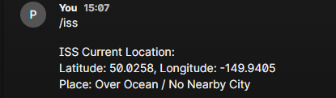

# astro-bot

Task 1: Webex Messaging API
The Webex Messaging API allows AstroBot to communicate with users through Webex spaces.My python programme uses HTTP GET requests to retrieve rooms and messages, and POST request to send responses.

API Base URL: https://webexapis.com/v1
Authentication Method: Bearer token found when signing into yor account on Webex
Endpoint to list rooms: GET /rooms
Endpoint to get messages: GET /messages?roomID={room_id}
Endpoint to send messages: POST /messages
Required Headers: Authorisation: Bearer (Your Webex token) and Content-type:application/json
Sample full GET request: GET https://webexapis.com/v1/rooms

get_rooms() function retrieves the available webex space
get_latest_messages() checks for any new commands
send_message() function sends responses back to the selected space

The access token is used for authentication

ISS Current Location API
The ISS shows the current coordinates of the International Space Station. The Astrobot uses the Open Notify API to retrive this information

API Base URL: https://api.open-notify.org
Endpoint for current ISS location: GET /iss-now.json
Sample response format (JSON):{"message":"success",
                                "timestamp":1471273200
                                "iss_position":{"latitude": "50.0258": "longitude": "-149.9405"}}
                            

get_iss_location() function sends a GET request using requests.get(url) to retrieve the ISS location
The JSON response is processed using response.json()
The latitude and longitude are taken from the iss_position

The coordinates are passed to a reverse_geocode() function to identify a nearby place. If no nearby locations is found the bot displays "Over Ocean/No Nearby City"

